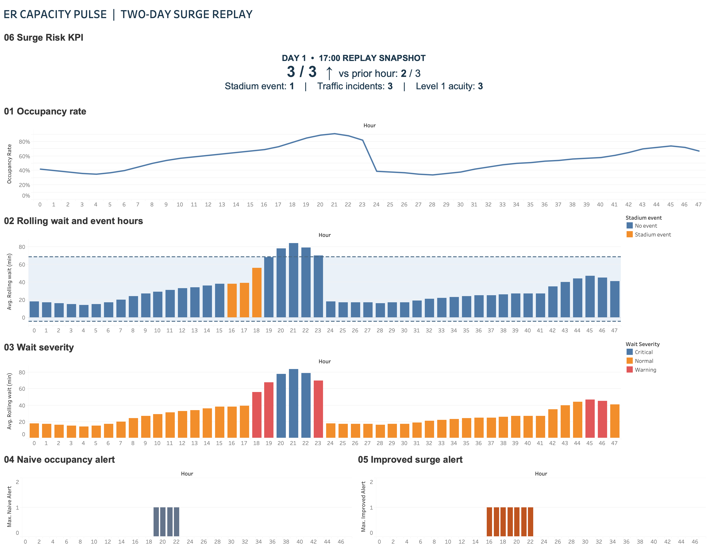

# ER Capacity Pulse — Emergency Room Surge Analytics

A Tableau case study that visualises emergency-room bed occupancy, waiting times and a simple surge-risk score. It compares an occupancy-only alert with an earlier signal based on a stadium event, traffic incidents and high-acuity patient counts.

## Open the project

1. Download [ER Capacity Pulse - Case 2.twbx](tableau/ER%20Capacity%20Pulse%20-%20Case%202.twbx).
2. Open it in Tableau Desktop. The package was saved with Tableau Desktop 2026.2 and includes its CSV data.
3. Begin with the dashboard, then inspect the individual worksheets. The KPI is a saved Day 1 17:00 replay snapshot, compared with 16:00; it is not a live feed.

The [unpacked workbook](tableau/unpacked/) is also available with its relative `Data/Data` folder. Keep those files together if opening the `.twb` version.

## What the views show

- **Occupancy:** occupied beds divided by available beds.
- **Waiting time:** hourly rolling-wait readings with an illustrative statistical band.
- **Wait severity:** Normal below 45 minutes, Warning from 45 to below 75, Critical at 75 or above.
- **Surge triggers:** stadium-event flag, traffic incidents and Level 1 acuity counts.
- **Alert comparison:** occupancy-only alert versus a three-condition early signal.
- **Replay KPI and detail:** selected-hour risk score, previous-hour comparison and the underlying hourly records.

## Dataset and case-study result

The submitted case-study CSV contains **48 hourly demo rows across two days**. These are synthetic teaching data, not patient records. Day 1 adapts the supplied 24-row demonstration, including waits of 38 and 39 minutes at Hours 16 and 17. Day 2 is a generated comparison day. The original supplied dataset is retained in `archive/original-project/`.

The surge score adds one point each for an active stadium event, at least two traffic incidents, and at least three Level 1 patients. The improved alert activates at a score of two; the naive alert activates at 85% occupancy. In the constructed Day 1 replay, the improved rule starts at 16:00, the wait first reaches Warning at 18:00, and the occupancy-only rule starts at 19:00. This demonstrates lead time within the scenario, not validated clinical prediction.

See [data and calculation notes](docs/DATA_AND_CALCULATIONS.md) for definitions and limits.

## Files

| Folder | Contents |
|---|---|
| `tableau/` | Final packaged workbook and unpacked copy with its relative data folder |
| `data/` | Submitted 48-row case-study CSV |
| `reports/` | Final case-study report in PDF and Word formats |
| `images/` | Individual chart captures and dashboard preview |
| `archive/original-project/` | Original supplied workbook, dataset and presentation |
| `archive/earlier-reports/` | Earlier report versions |
| `archive/ER project working files.zip` | Case-study preparation scripts, intermediate workbook versions and captures |

## Academic project

**Subject:** Interactive Data Visualization Techniques and Analysis — 21IPE313P  
**Faculty:** Dr. Jeba Sonia J (102863)

- Mukul Parashar — RA2311027010008
- Lingam Gaurav Kumar — RA2311027010006
- Krishna Lodha — RA2311056010095

## Limitations

This project is an educational replay with hand-designed rules. It has no live hospital connection, no real patient data and no validated clinical forecasting model. “Level 1” represents the case’s highest-acuity count. The severity distribution groups hourly wait readings; it does not establish the number of emergency versus non-emergency patients. Staffing and escalation suggestions require professional review before any real use.
